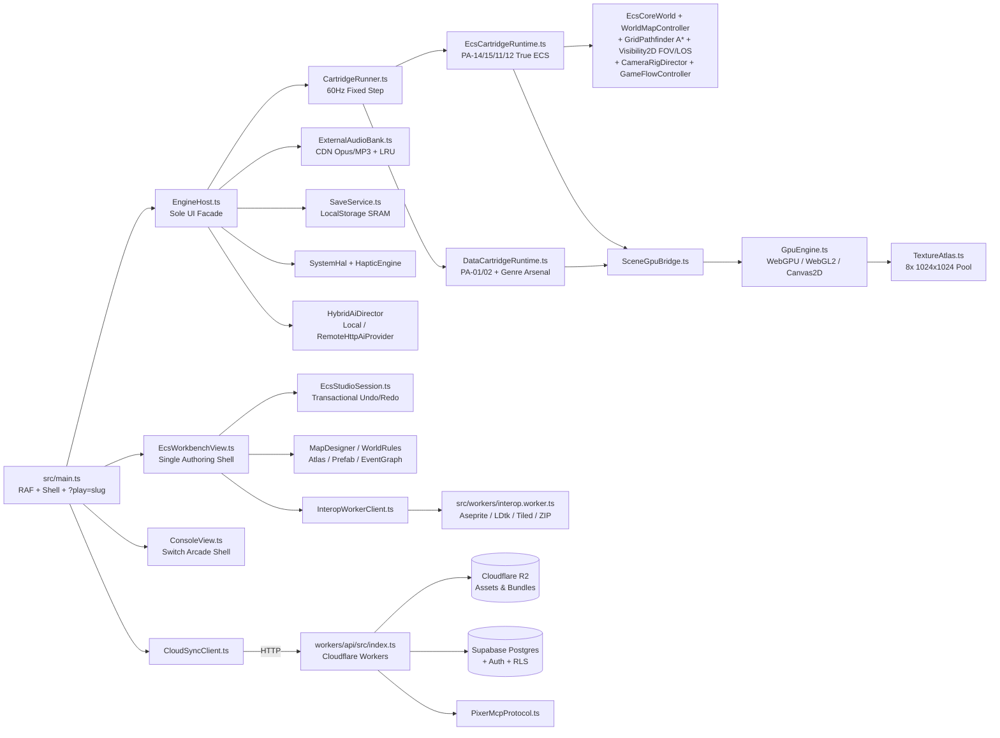

# Pixer Codebase Navigation Map (Zero-Grep Routing Guide)

> **Purpose**: Read this file FIRST (together with `AGENTS.md`) to locate exact files, symbols, and cross-module call chains in **1 lookup** instead of broad directory scans.
> **Snapshot**: 201 code files · ~92,650 LOC · Primary Entry: `src/main.ts` · Worker Entry: `src/workers/interop.worker.ts` · Edge API Entry: `workers/api/src/index.ts`.

---

## 1. End-to-End Runtime Architecture & Call Chains

---

## 2. Task-to-File Quick Routing Table (Jump Straight Here)

| 要修改／排查的功能 | 必看入口檔（按順序） | 對應驗證測試 |
|---|---|---|
| **啟動流程、`?play=<slug>`、雙模式切換** | `src/main.ts` → `src/AppShellHelpers.ts` → `src/ui/PixerPlatformShell.ts` | `npm run build` |
| **WebGPU / WebGL2 / Canvas2D PBR 著色器與打光** | `src/core/gpu/GpuEngine.ts` → `WebGpuBackend.ts` / `WebGpuShaders.ts` / `WebGl2Backend.ts` / `WebGl2Shaders.ts` → `SceneGpuBridge.ts` | `scripts/sim/ArchitectureTests.ts`, `CoreSubsystemTests.ts` |
| **8 頁圖集、自訂精靈編譯、調色盤** | `src/assets/TextureAtlas.ts` → `src/core/ecs/EcsCustomSpriteCompiler.ts` → `src/assets/sprites/PaletteData.ts` | `scripts/sim/WorldMap.test.ts`, `Pixer7Tests.ts` |
| **真 ECS 世界、多房間地圖、傳送門、機關、A* 尋路 AI** | `src/core/ecs/EcsCartridgeRuntime.ts` → `EcsSnapshotProjector.ts` / `EcsWorldMapController.ts` → `GridPathfinder.ts` / `Visibility2D.ts` → `EcsActionPhysicsSystems.ts` → `EcsProjectSchema.ts` / `EcsTilemapTypes.ts` | `scripts/sim/EcsCore.test.ts`, `scripts/sim/WorldMap.test.ts`, `Engine10Core.test.ts` |
| **ECS 編輯器交易指令（Undo/Redo）與 MCP 工具** | `src/core/ecs/EcsStudioSession.ts` → `src/core/ai/PixerMcpProtocol.ts` → `src/core/ai/AgentBridge.ts` → `scripts/pixer-mcp.ts` | `scripts/sim/EcsCore.test.ts`, `WorldMap.test.ts` |
| **無損事件圖 ↔ 腳本 VM** | `src/core/ecs/EcsEventGraph.ts` → `src/core/ecs/SandboxScriptVm.ts` → `src/ui/EventGraphEditorView.ts` | `scripts/sim/EcsCore.test.ts` |
| **工作站 UI（架構/階層/地圖/規則/檢視器）** | `src/ui/EcsWorkbenchView.ts` → `EcsWorkbenchShellBuilder.ts` / `EcsWorkbenchMapCanvasController.ts` / `EcsWorkbenchHierarchyPanels.ts` / `EcsWorkbenchEntityInspector.ts` / `EcsWorkbenchSceneInspector.ts` / `EcsWorldRulesInspectorPanel.ts` / `EcsMapDesignerPanel.ts` / `EcsWorkbenchAtlasPanel.ts` / `EcsWorkbenchPrefabInspector.ts` | `scripts/sim/WorldMap.test.ts`, `ArchitectureTests.ts` |
| **像素畫室（繪製精靈與一鍵發佈瓦片/印章）** | `src/ui/SpriteAtelierView.ts` → `src/ui/SpriteAtelierPixelOps.ts` → `src/main.ts` (`onPublishMapTile` / `onPublishPrefabStamp`) | `npm run build` |
| **外部匯入（Aseprite / LDtk / Tiled / ZIP）** | `src/ui/ExternalImportModalView.ts` → `InteropWorkerClient.ts` → `src/workers/interop.worker.ts` → `src/core/interop/{InteropBundleLoader,AsepriteParser,LdtkImporter,TiledImporter}.ts` | `scripts/sim/Interop.test.ts` |
| **掌機殼、輸入、震動、實體手把** | `src/ui/ConsoleView.ts` → `ConsoleSpatialController.ts` / `ConsoleShellRouter.ts` / `VirtualGamepadInput.ts` / `GamepadHardwareBridge.ts` → `src/core/input/*` & `src/core/hal/*` | `scripts/sim/HalAndInputTests.ts` |
| **內建卡匣內容（PA-14/15/01/02/11/12）** | `src/game/BuiltinCartridges.ts` → `src/game/{obsidianCitadel,emeraldRuins,rhythmBastion,astralRift}/*` | `scripts/sim/CartridgeActionTests.ts`, `WorldMap.test.ts` |
| **PA-01 / PA-02 資料卡匣與全品類子引擎（格鬥/卡牌/推箱）** | `src/core/sim/DataCartridgeRuntime.ts` → `DataRuntimePlatformer.ts` / `DataRuntimeSnapshot.ts` / `DataRuntimeShmup.ts` / `CardDeckEngine.ts` / `FighterFrameEngine.ts` / `GenreControllers.ts` / `CartridgeSchema.ts` | `scripts/sim/CartridgeActionTests.ts`, `Engine10Core.test.ts` |
| **外部音訊層（無 AI 合成）** | `src/core/audio/ExternalAudioBank.ts`（相容別名 `ToySynth.ts`）→ `src/core/runtime/EngineHost.ts` | `scripts/sim/CloudOffload.test.ts`, `ArchitectureTests.ts` |
| **雲端疏導（R2 CDN + Supabase + Edge API）** | `src/core/cloud/CloudSyncClient.ts` → `workers/api/src/{index,supabaseStore,types}.ts` → `supabase/migrations/20261122000000_pixer_cloud_schema.sql` | `scripts/sim/CloudOffload.test.ts` |
| **空間可達性預言機 & 腳本化試玩驗證** | `src/core/ai/EcsSpatialOracle.ts` → `src/core/ai/EcsPlaytestVerifier.ts` | `scripts/sim/EcsCore.test.ts`, `DualPerspective3D.test.ts` |

---

## 3. Layer-by-Layer Module Inventory

### A. Pure Engine Core (`src/core/` — Zero UI / Zero `src/game/` / Zero Capacitor)
- **`src/core/gpu/` (9 files, 6,960L)** *(Canvas/WebGPU/WebGL2 DOM allowed)*
  - `GpuEngine.ts` (1,117L) — Multi-backend coordinator, 24-float PBR 2D instancing, shadow grid, atlas sync.
  - `GpuQuad3DBatch.ts` (750L) + `GpuColorCache.ts` (49L) — Zero-GC 3D Quad batching/geometry emitters & bounded packed hex RGB cache.
  - `WebGpuBackend.ts` (1,357L) + `WebGpuShaders.ts` (1,060L) — Primary WGSL pipeline + 3-Pass Karis Bloom.
  - `WebGl2Backend.ts` (881L) + `WebGl2Shaders.ts` (1,035L) — GLSL ES 3.00 parity backend.
  - `Canvas2DBackend.ts` (517L) — Guaranteed software fallback.
  - `GpuTypes.ts` (194L) — Viewport presets (`1280×720`), `AtlasPoolStats`, PBR structs.
- **`src/core/ecs/` (15 prod files, 9,472L)** *(100% DOM-free; zero `*.test.ts` inside `src/`)*
  - Core primitives: `EntityManager.ts` (163L), `ComponentStore.ts` (556L), `EcsCoreWorld.ts` (208L), `EcsWorld.ts` (465L).
  - Schema & authoring: `EcsProjectSchema.ts` (642L), `EcsTilemapTypes.ts` (579L), `EcsStudioSession.ts` (1,205L), `EcsCustomSpriteCompiler.ts` (567L).
  - Runtime, projection & scripting: `EcsCartridgeRuntime.ts` (1,161L, integrates `CameraRigDirector` & `GameFlowController`), `EcsSnapshotProjector.ts` (760L, Zero-GC snapshot/light/HUD/FP-wall projector), `EcsWorldMapController.ts` (1,415L, integrates Zero-GC `GridPathfinder` A* + `Visibility2D` LOS/FOV), `EcsActionPhysicsSystems.ts` (799L), `SandboxScriptVm.ts` (478L), `EcsEventGraph.ts` (471L), `index.ts` (11L).
  - Unit tests live in `scripts/sim/EcsCore.test.ts` (1,328L), enforced by `ArchitectureTests.ts`.
- **`src/core/runtime/` (17 files, 5,243L)** *(100% DOM-free, 100% Wired)*
  - `EngineHost.ts` (589L, **sole UI facade**), `CartridgeRunner.ts` (480L), `CartridgeRegistry.ts` (153L), `CameraRigDirector.ts` (566L, 6DoF camera director wired into `EcsCartridgeRuntime`), `GameFlowController.ts` (222L, 6-act flow controller wired into `EcsCartridgeRuntime`), `SceneGpuBridge.ts` (889L), `SceneFirstPersonPass.ts` (243L, 2.5D DDA pass), `SceneTrue3DPass.ts` (320L, True 3D HD-2D pass), `SceneOrthogonalHelper.ts` (64L), `SceneHudOverlayPass.ts` (113L), `DisplayThermalGovernor.ts` (196L), `SaveService.ts` (348L), `CartridgePngCodec.ts` (268L), `AppLogger.ts` (339L), `LogPersistence.ts` (325L), `EventBus.ts` (86L), `SeededRng.ts` (37L).
- **`src/core/ai/` (10 files, 3,495L)** *(100% DOM-free)*
  - Authoring & MCP: `AgentBridge.ts` (460L), `PixerMcpProtocol.ts` (485L), `EcsSpatialOracle.ts` (1,292L), `EcsPlaytestVerifier.ts` (376L), `ObservationSerializer.ts` (153L).
  - Providers: `HybridAiDirector.ts` (182L), `LocalAiProvider.ts` (260L), `RemoteAiProvider.ts` (191L), `AiTypes.ts` (76L), `AiProvider.ts` (20L).
- **`src/core/interop/` (6 files, 3,150L)** *(100% DOM-free; executed in Web Worker)*
  - `InteropBundleLoader.ts` (573L), `AsepriteParser.ts` (669L), `LdtkImporter.ts` (766L), `TiledImporter.ts` (641L), `InteropTypes.ts` (495L), `index.ts` (6L).
- **`src/core/cloud/` (2 files, 306L)** *(100% DOM-free)*
  - `CloudSyncClient.ts` (295L) + `index.ts` (11L) — Shared project fetch/publish (ETag), R2 upload, SRAM merge.
- **`src/core/audio/` (2 files, 458L)** *(Web Audio/HTMLAudio only; zero procedural oscillators)*
  - `ExternalAudioBank.ts` (447L), `ToySynth.ts` (11L legacy alias).
- **`src/core/math/` (6 files, 2,091L)** *(100% DOM-free, Zero-GC, 100% Wired)*
  - `ColorMath.ts` (391L), `NoiseMath.ts` (253L), `Perspective3DMath.ts` (254L), `SpatialHash.ts` (349L), `SpringDynamics.ts` (409L), `Visibility2D.ts` (435L, wired into `EcsWorldMapController` & `ProceduralStageCompiler`).
- **`src/core/input/` (5 files, 889L)** & **`src/core/hal/` (2 files, 513L)** *(100% DOM-free)*
  - Input DSP: `InputPipeline.ts`, `InputMap.ts`, `DpadClusterMath.ts`, `StickShaper.ts`, `WebGamepadSampler.ts`.
  - HAL: `SystemHal.ts`, `HapticEngine.ts`.
- **`src/core/types/` (5 files, 754L)**: `WorldTypes.ts` barrel → `SceneTypes.ts`, `HudTypes.ts`, `InputTypes.ts`, `CartridgeTypes.ts`.
- **`src/core/sim/` (21 files, 14,501L)** & **`src/core/editor/` (3 files, 1,622L)** *(Data Runtime + Shared Primitives + Multi-Genre Arsenal)*
  - Core & Genre Sub-Engines: `DataCartridgeRuntime.ts` (1,452L coordinator), `DataRuntimePlatformer.ts` (1,026L platformer/grapple/dual-perspective), `DataRuntimeSnapshot.ts` (998L Zero-GC ping-pong snapshot & HUD projector), `DataRuntimeShmup.ts` (1,111L), `CardDeckEngine.ts` (975L roguelike deckbuilder sub-engine), `FighterFrameEngine.ts` (790L 60fps frame-data 2D fighter sub-engine), `GenreControllers.ts` (1,488L fighter/card/topdown/grid puzzle & HUD pool), `CartridgeSchema.ts` (987L), `GridPathfinder.ts` (522L, Zero-GC Binary-Heap A* & Flow-Field wired into `EcsWorldMapController`), `TilemapGrid.ts`, `SoaEntityPool.ts`, `EventActionVm.ts`, `JuiceSystem.ts`, `DualPerspectiveRuntime.ts`, `PerspectiveProjector.ts`, `ProceduralStageCompiler.ts`, `ProceduralVisualRig.ts`, `OrthogonalArt.ts`, `AnimationStateMachine.ts`, `BehaviorTree.ts`, `TweenSystem.ts`.
  - `src/core/editor/`: `StudioSession.ts` (231L), `StudioCommands.ts` (1,012L), `StudioPlaytestDiag.ts` (379L).

### B. Assets, Games & Edge Cloud
- **`src/assets/` (15 files, 4,952L)**: `TextureAtlas.ts` (740L), `AtlasSpritesData.ts`, `WorkshopRecipes.ts`, `sprites/*` (`CastleSprites`, `HdMaterialSprites`, `PaletteData`, `CoreSprites`, `ChronicleSprites`, `ParkourSprites`, `DungeonSprites`, `AutoTileSprites`, `ShmupSprites`, `MomoSprites`, `PixelFontData`, `BossSprites`).
- **`src/game/` (5 files, 2,529L)**: `BuiltinCartridges.ts` (`PA-01` Cloudberry Hop + `PA-02` Sugar Starlight + ECS registrations) + `obsidianCitadel/` (`PA-14`), `emeraldRuins/` (`PA-15`), `rhythmBastion/` (`PA-11`), `astralRift/` (`PA-12`).
- **`workers/api/` (3 TS + `wrangler.toml`, 732L)** & **`supabase/` (1 SQL, 122L)**: Edge API (`handleEdgeRequest`, `createSupabaseMetadataStore`) + PostgreSQL 4-table RLS migration.

### C. UI Workstation, Arcade Shell & Styles (`src/ui/` 51 files + `src/styles/` 4 CSS = 24,280L)
- **Workstation (`EcsWorkbench`)**: `PixerPlatformShell.ts`, `EcsWorkbenchView.ts` (868L coordinator), `EcsWorkbenchShellBuilder.ts` (408L DOM layout), `EcsWorkbenchCatalog.ts` (305L registries/diagnostics), `EcsWorkbenchLiveMutator.ts` (183L live preview), `EcsWorkbenchMapCanvasController.ts` (366L 2D/3D map pointer/overlay), `EcsWorkbenchHierarchyPanels.ts` (274L), `EcsWorkbenchEntityInspector.ts` (772L), `EcsWorkbenchSceneInspector.ts` (250L), `EcsWorkbenchPrefabInspector.ts` (346L), `EcsWorkbenchAtlasPanel.ts` (259L), `EcsWorldRulesInspectorPanel.ts` (770L), `EcsMapDesignerPanel.ts` (664L), `EventGraphEditorView.ts` (1,148L), `ExternalImportModalView.ts` (560L), `InteropWorkerClient.ts` (149L), `SpriteAtelierView.ts` (1,313L), `SpriteAtelierPixelOps.ts` (494L).
- **Arcade Shell (`ConsoleView`)**: `ConsoleView.ts` (664L), `ConsoleSpatialController.ts` (150L), `ConsoleShellRouter.ts`, `ConsoleBodyBuilder.ts`, `ConsoleJoyconBuilder.ts`, `ConsoleHudPresenter.ts`, `CartridgeSlotController.ts`, `HomeLobbyView.ts`, `DeskWorldView.ts`, `WindowDioramaView.ts` (356L), `DioramaPalette.ts` (266L), `DioramaSceneRenderer.ts` (617L), `BootBlinkOverlay.ts`, `AngledSystemMenuView.ts`, `CartridgeDrawerView.ts`, `IrisWipeTransition.ts`, `ShmupOverlayView.ts`, `CardArt.ts`, `ProceduralSurfaceTextures.ts`, `MomoMascot.ts`, `TransitionMascot.ts`.
- **Input / Settings / Native**: `VirtualGamepadInput.ts`, `GamepadHardwareBridge.ts`, `TouchControlsBuilder.ts`, `TouchStateMerger.ts`, `SystemSettingsDrawerView.ts`, `SettingsDrawerTypes.ts`, `SystemLogPanelView.ts`, `CapacitorNativeBridge.ts`, `PwaBridge.ts`, `BrowserAssetLoader.ts`, `PixelIcons.ts`, `dom.ts`.
- **Styles**: `switch.css` (2,100L), `lobby.css` (1,928L), `atelier.css` (1,847L), `studio7.css` (1,702L).

---

## 4. Architecture Boundary Rules (Enforced by `scripts/sim/ArchitectureTests.ts`)

| Layer | Allowed Imports | Forbidden Imports |
|---|---|---|
| `src/core/{ai,cloud,ecs,editor,hal,input,interop,math,runtime,sim,types}/` | Own peers, `src/assets/`, pure npm (`fflate`, `maxrects-packer`) | `src/ui/`, `src/game/`, `@capacitor/*`, `virtual:pwa-register`, DOM globals (`document`/`window`/`HTMLElement`) |
| `src/core/gpu/` & `src/core/audio/` | `src/core/*`, `src/assets/` | `src/ui/`, `src/game/`, `@capacitor/*`, `createOscillator` (in `ExternalAudioBank.ts`) |
| `src/assets/` & `src/game/` | `src/core/*` | `src/ui/`, DOM globals |
| `src/ui/` | `EngineHost` (**never** `.runner`), `src/core/*`, `src/assets/`, `src/game/` | `eval()`, `new Function()`, leaking listeners without `AbortController` + `destroy()` |
| `workers/api/src/` | Web Standards (`fetch`, `crypto.subtle`), pure `src/core/*` | Node-only built-ins (`node:fs`, `node:path`), browser DOM |
